# Claimora — Expense Approval System

Claimora is a web app for expense claims and their approval. Employees create claims with receipts. Managers review their team's claims, and Finance signs off larger claims and records payments. Every status change is checked on the server and written to an audit trail.

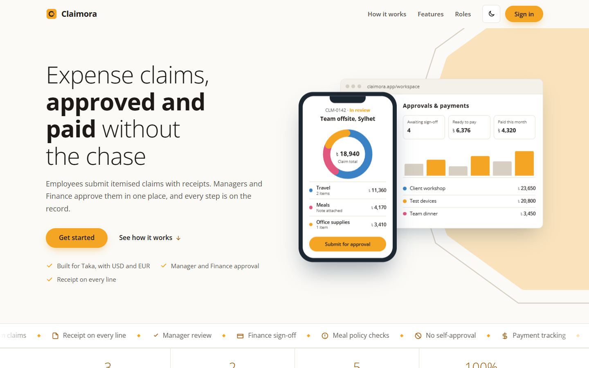

## Features

- **Employees**
  - Create a claim with one or more expense lines. Each line has a date, category, amount, currency, description, optional note and receipt.
  - Save the claim as a draft or submit it for approval.
  - Edit and resubmit a claim after it is rejected.
- **Managers**
  - See the review queue for their direct reports, oldest first.
  - Approve, or reject with a required comment.
- **Finance**
  - Sign off on manager-approved claims over ৳1,000.
  - Mark approved claims as paid.
  - Use a spend dashboard with filters and charts.
  - Export to a branded Excel workbook (`.xlsx`) or CSV.
- **Audit trail**: every claim records who did what, when, the status before and after, and the comment.
- **Interface**
  - Amounts in Taka (৳) with lakh/crore grouping.
  - Light and dark themes.
  - Layouts for desktop and phone.

## Setup

### Option A: Docker (recommended)

1. Install and start [Docker Desktop](https://www.docker.com/products/docker-desktop/).
2. Clone the repository and open a terminal in the project folder:
   ```bash
   git clone https://github.com/Pranto-Roy-10/expense-approval-system.git
   cd expense-approval-system
   ```
3. Build and start the app:
   ```bash
   docker compose up --build
   ```
4. Open <http://localhost:5000> and choose a role on **Get started**.
5. Stop it with `Ctrl+C`, or with `docker compose down`. Add `-v` to that command to also wipe the data.

### Option B: Python 3.11+

1. Clone the repository and open a terminal in the project folder (as above).
2. Install the dependencies:
   ```bash
   python -m pip install -r requirements.txt
   ```
3. Start the app:
   ```bash
   python run.py
   ```
4. Open <http://127.0.0.1:5000>.
5. To start again from fresh sample data, stop the app and delete `instance/expenses.db`.

On first start the app creates the database and fills it with sample people and claims, so no other setup is needed.

### How the Docker setup works

- **`Dockerfile`**
  - Starts from the official `python:3.13-slim` image.
  - Installs `requirements.txt` and the Gunicorn production server, then copies the code in.
  - Runs Gunicorn with two workers on `0.0.0.0:5000`, so the server can be reached from outside the container. `--preload` sets the app up once before the workers start.
  - `.dockerignore` keeps the local database, `.env`, virtual environments, caches and git history out of the image.
- **`compose.yaml`**
  - Builds that image as the `web` service.
  - Maps port 5000 in the container to port 5000 on your computer.
  - Passes `SECRET_KEY` through from your shell or a `.env` file. When it is not set, the app picks a random key at each start.
  - Mounts a named volume, `instance`, at `/app/instance`. The SQLite database and uploaded receipts live there, so they survive restarts and rebuilds.
  - `docker compose down` keeps the volume, and `docker compose down -v` deletes it.
- **First run**: the app finds an empty database, creates the tables and loads the sample data, as it does outside Docker.

### Sample accounts

On **Get started**, pick a role to sign in as one of these accounts. You can also create an account with email and password under **Sign up**.

| Role     | Name          | Email                    |
|----------|---------------|--------------------------|
| Employee | Nusrat Jahan  | nusrat.jahan@claimora.app |
| Manager  | Tanvir Ahmed  | tanvir.ahmed@claimora.app |
| Finance  | Farhana Islam | farhana.islam@claimora.app |

Rafiq Hasan and Sadia Rahman are two more employees on Tanvir Ahmed's team.

### Configuration

| Variable       | Default                    | Purpose |
|----------------|----------------------------|---------|
| `SECRET_KEY`   | random on each start       | Signs the session cookie. Set a long random value so sign-ins survive a restart. |
| `DATABASE_URL` | `sqlite:///expenses.db`    | SQLAlchemy database URL. |

Values can also be placed in a `.env` file at the project root.

## Running the tests

```bash
python -m pytest -q
```

There are 76 tests:

- `tests/test_rules.py` covers every business rule.
- `tests/test_flows.py` runs full journeys through the HTTP layer: create, submit, review, reject and resubmit, pay, permissions, CSRF, receipts and exports.
- `tests/test_landing.py` and `tests/test_health.py` cover the public pages.
- `tests/test_seed.py` loads the sample data through the real rules, so a rule change that breaks it fails a test instead of the app start-up.

GitHub Actions runs the suite on every push and pull request (`.github/workflows/tests.yml`).

## Business rules

Claim statuses move through **Draft → Submitted → Approved → Paid**. **Rejected** sends the claim back to the employee.

| Rule | Where it is enforced |
|------|----------------------|
| A claim needs at least one line, and every line needs a date, category, description, currency and an amount above zero. | `rules.validate_items` |
| A Meals line over ৳50 (after currency conversion) needs a note. | `rules.validate_items` |
| Only the owner can submit, and only from Draft or Rejected. | `rules.submit` |
| Nobody can approve or reject their own claim. | `rules._check_reviewer` |
| The employee's manager reviews first. A claim over ৳1,000 then goes to Finance before it counts as approved. | `rules.approve` |
| A rejection needs a comment. | `rules.reject` |
| Only Finance can mark a claim as paid, and only once it is approved. | `rules.mark_paid` |
| Only Draft or Rejected claims can be edited or deleted. | `claims.py` |
| Every POST carries a CSRF token, and every page checks the user's role. | `auth.py` |

Line amounts are converted to Taka at fixed rates: 1 USD = ৳122 and 1 EUR = ৳132. Every total and threshold uses the Taka value.

## Architecture

The app is a server-rendered Flask application: an app factory, three blueprints and SQLite through Flask-SQLAlchemy. All business rules live in one module with no HTTP code. Routes stay thin, and every way of changing a claim goes through the same checks.

```
app/
  __init__.py     app factory, blueprint registration, static-file cache busting
  config.py       settings from the environment
  models.py       User, Claim, ClaimItem, AuditEntry; categories and currency rates
  rules.py        validation and every status change; writes the audit entry
  auth.py         sign-in, sign-up, sign-out, CSRF check, role-based login_required
  claims.py       create, edit, delete, submit, approve, reject, pay, receipt download
  routes.py       landing page, role workspaces, dashboard, exports, profile
  dashboard.py    filtered spend figures for the Finance dashboard
  export.py       branded Excel workbook (XlsxWriter)
  seed.py         sample people and claims for an empty database
  templates/      Jinja pages: landing, auth, workspace/*, claims/*, dashboard, profile
  static/         CSS, JavaScript (forms, charts, motion), favicon
tests/            pytest suite with an in-memory database
Dockerfile, compose.yaml
```

- **Data**
  - A `Claim` belongs to an employee and has many `ClaimItem` lines and `AuditEntry` rows.
  - Each user has a role (`employee`, `manager` or `finance`) and an optional manager.
  - Receipts (PDF or image, up to 5 MB each) are stored under `instance/receipts`.
  - Only the claim's owner, their manager and Finance can open a claim and its receipts. Drafts stay private to the owner.
- **Front end**
  - Jinja templates with plain CSS and small JavaScript modules.
  - Chart.js draws the dashboard charts, and GSAP handles the motion.
  - Both are loaded from a CDN.

## Screenshots

**Get started.** Choose a role to sign in.

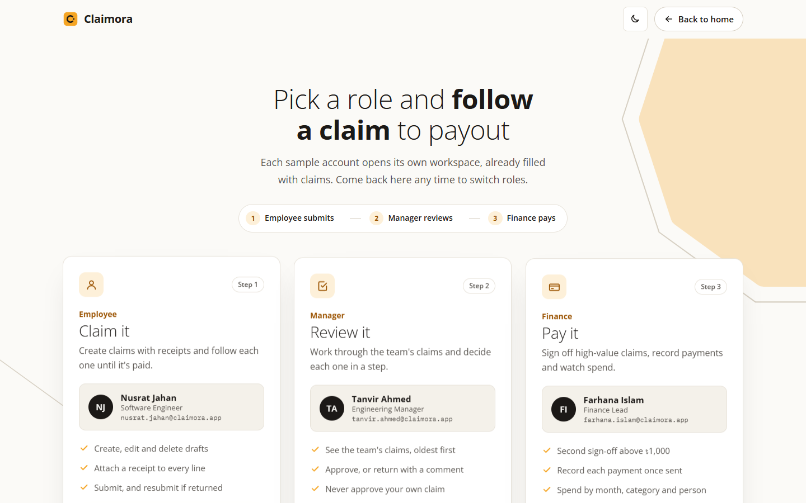

**Employee workspace.** Claims grouped by status, with totals.

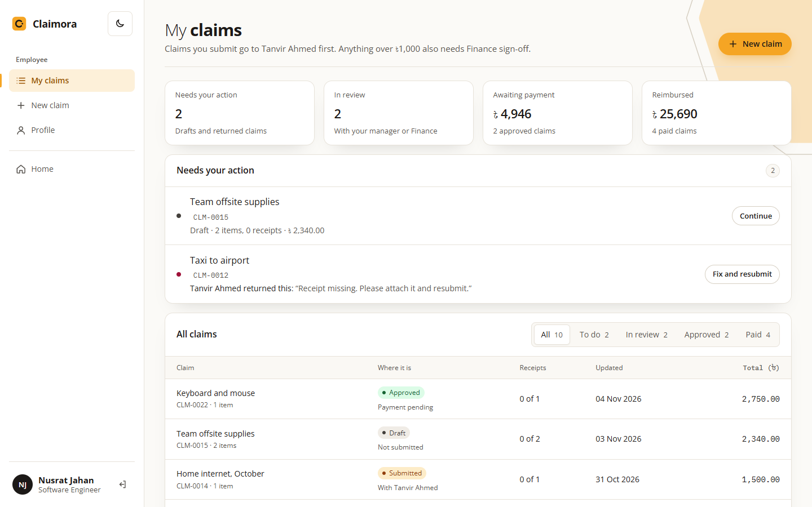

**New claim.** Line items, live total in Taka and a pre-submit checklist.

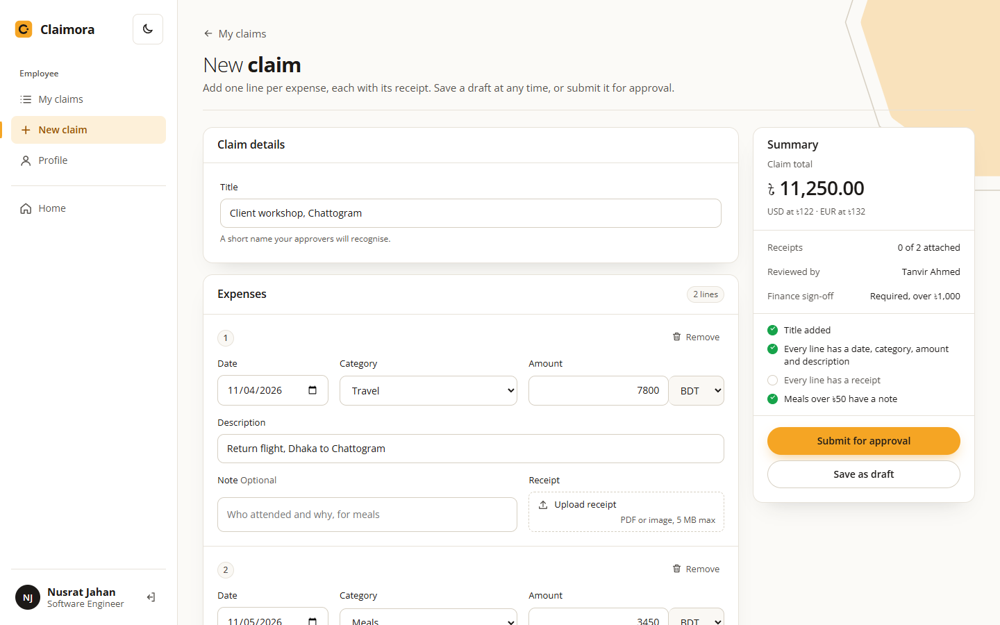

**Claim detail.** Lines, receipts, approval route and audit trail.

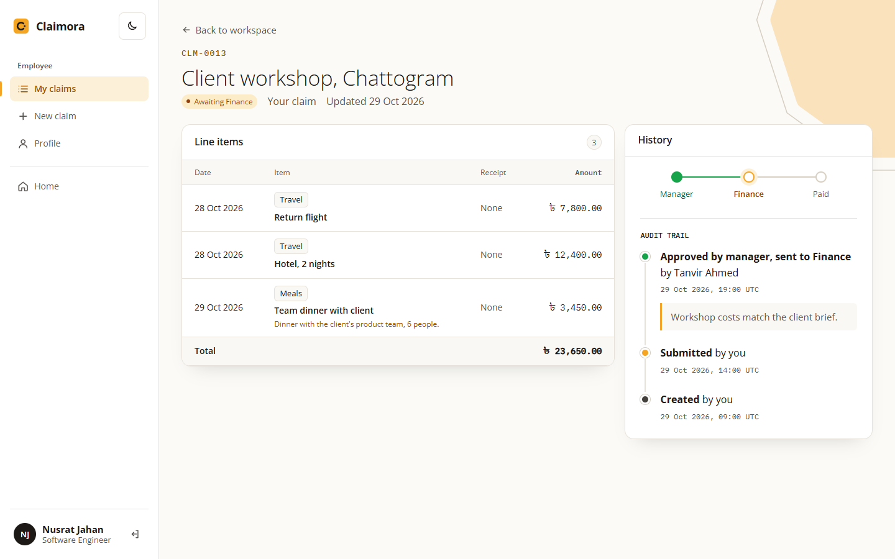

**Manager review queue.**

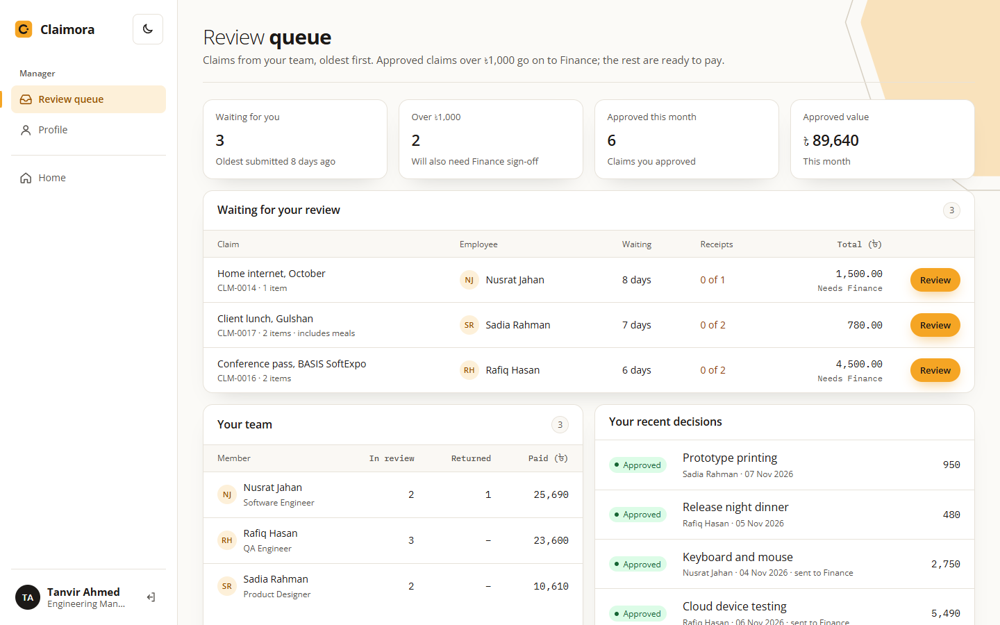

**Finance approvals and payments.**

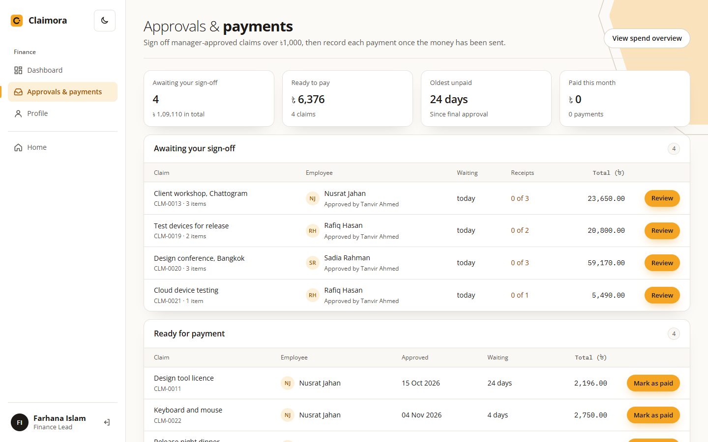

**Finance spend dashboard.** Filters, charts and Excel export.

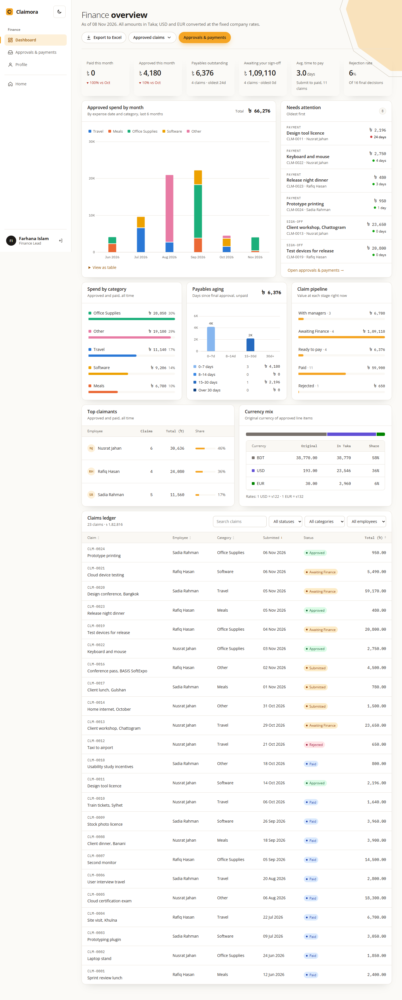

**Profile.**

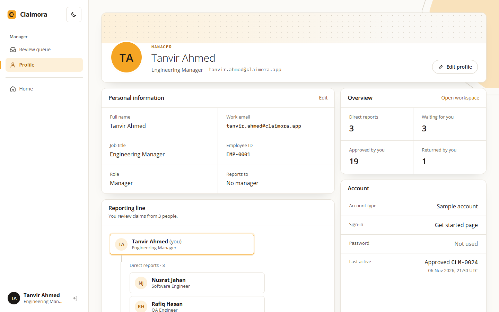

**Dark theme.**

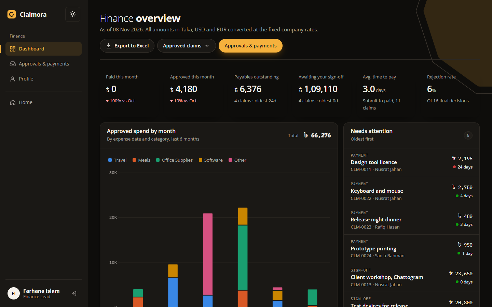

**Phone.**

<p>
  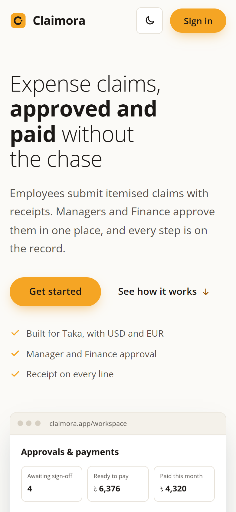
  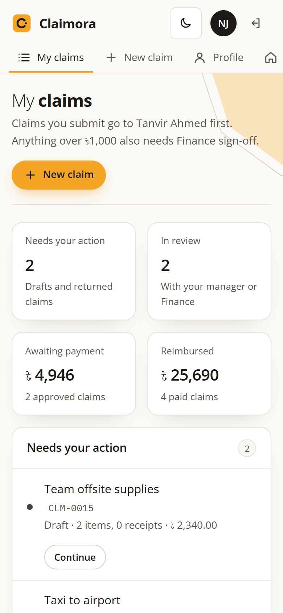
</p>

## Assumptions

- **Stack.** Flask with server-rendered templates was used instead of React or Angular. It keeps the app to one process and one language, and lets every rule run on the server.
- **Base currency.** Taka is the base currency, with fixed conversion rates. A live rate feed was out of scope.
- **"Over ৳1,000"** means strictly greater than ৳1,000, measured on the claim's total in Taka.
- **Rejection.** A rejected claim goes back to the employee, who can edit and resubmit it. Resubmission starts the approval route again from the manager.
- **Approved export.** The approved-claims export also includes claims that are already paid, because they were approved first.
- **Sign-in.** The sample accounts sign in without a password to make reviewing quick. Accounts created through sign-up use a hashed password.
- **Manager required.** Every employee needs a manager before they can submit. Each manager reviews only their own direct reports.
- **Roles are self-chosen.** Real authentication is out of scope, so sign-up lets people pick any role, and an employee can change their manager on the profile page. In a real deployment, an administrator would assign roles and managers.
- **Windows note.** On Windows, if both Docker and a local `python run.py` are running, `127.0.0.1:5000` reaches the local process and `localhost:5000` may reach the container. Run one at a time.
